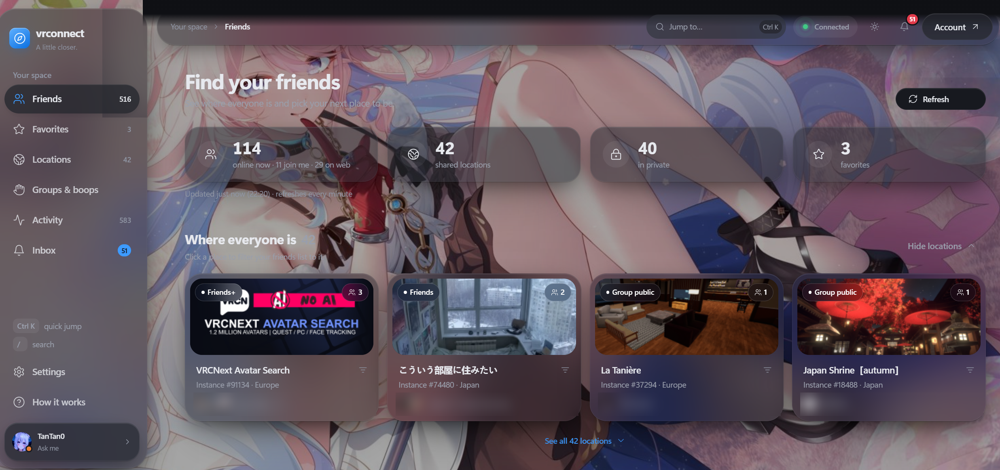

<div align="center">

# 🧭 vrconnect

### Your VRChat friends, a little closer.

A self-hosted dashboard to see where your friends are, set your status,<br/>
and keep up with invites — **without opening the game**.

<br/>


<br/>


<br/>



<sub>Custom wallpaper and accent colour · friends' names blurred for privacy</sub>

<br/><br/>

[✨ Features](#-features) · [🚀 Quick start](#-quick-start-windows) · [🔐 Security](#-security) · [🤝 Contributing](#-contributing) · [💙 Contributors](#-contributors)

</div>

---

## ✨ Features

<table>
<tr>
<td width="50%" valign="top">

### 👥 Friends
- 🟢 **Live friends list** with status dots in VRChat's own colours: <br/>🔵 Join Me · 🟢 Online · 🟠 Ask Me · 🔴 Do Not Disturb
- 🌐 **Website presence**: friends on vrchat.com count as online, with their own section and a hollow blue ring
- ⭐ **Favorites**, private notes, search, filters and sorting
- 🕒 **Activity timeline**: who came online, changed world or status

</td>
<td width="50%" valign="top">

### 🌍 Locations
- 🗺️ **Where everyone is**: friends grouped by world and instance, with world pictures
- 👤 **Live head-count** of everyone in the instance, not only your friends, plus its capacity
- 🔒 Instance type and region at a glance (Friends+, Group public, Invite…)
- ↗️ **One-click join** for instances you can enter

</td>
</tr>
<tr>
<td width="50%" valign="top">

### 🙋 You
- 💬 **Set your status and status message** right from the sidebar, with your recent messages one click away
- 👥 **Friend groups**: make your own, or **import your VRChat favorite groups** (VRChat+ groups included)
- 👋 **Boops, invites and invite requests**, to one friend or a whole group

</td>
<td width="50%" valign="top">

### 🎨 Make it yours
- 🖼️ **Wallpaper**: your own image or a link, with darken and blur controls
- 🎨 **Accent colour**: presets or any colour you like
- 🌗 Light, dark or system theme · compact list · animation toggles
- 🔔 Notification center with optional sounds and desktop alerts

</td>
</tr>
</table>

---

## 🚀 Quick start (Windows)

### Prerequisites

| Tool | Version |
|------|---------|
| [.NET SDK](https://dotnet.microsoft.com/download) | **10** |
| [Node.js](https://nodejs.org/) | **22.12 or newer** (LTS recommended) |
| [PostgreSQL](https://www.postgresql.org/download/) | any recent version |

> 💡 Don't want to install these yourself? Build the **one-click Windows installer**: see [`installer/README.md`](installer/README.md).

### Three steps

```powershell
# 1. Get the code
git clone <this repository> && cd VRChatDashboard-OpenSource

# 2. First-time setup (right-click → "Run with PowerShell")
.\SETUP.ps1

# 3. Launch: starts the API + dashboard and opens your browser
.\START.bat
```

`SETUP.ps1` asks for your PostgreSQL credentials, generates a random JWT key, applies the database migrations and installs the frontend packages.

| Service | Address |
|---------|---------|
| 🖥️ Dashboard | http://localhost:8080 |
| ⚙️ API | http://localhost:5000 |
| 📖 API docs (Swagger) | http://localhost:5000/swagger |

### 🔄 Updating

After pulling a new version, reinstall the frontend packages:

```bash
cd vrchat-friends-ui && npm install
```

<details>
<summary><b>🛠️ Manual setup</b> (without the scripts)</summary>

<br/>

**1. Configure the API.** Copy `DashboardVRChat.Api/appsettings.example.json` to `appsettings.json` and fill in your values:

```json
{
  "ConnectionStrings": {
    "DefaultConnection": "Host=localhost;Port=5432;Database=chatdb;Username=YOUR_USER;Password=YOUR_PASSWORD"
  },
  "Jwt": {
    "Key": "YOUR_RANDOM_SECRET_MIN_32_CHARS"
  }
}
```

> ⚠️ **Never commit real credentials.** Keep your real `appsettings.json` local.

**2. Apply database migrations**

```bash
cd DashboardVRChat.Api
dotnet ef database update
```

**3. Run the API**

```bash
dotnet run
```

**4. Configure the frontend** (only if your API isn't on the default address). Copy `vrchat-friends-ui/.env.example` to `.env.local`:

```env
VITE_API_URL=http://localhost:5000
```

**5. Run the frontend**

```bash
cd vrchat-friends-ui
npm install
npm run dev
```

</details>

<details>
<summary><b>⌨️ Useful commands</b></summary>

<br/>

```bash
npm run test    # run the test suite (Vitest)
npm run build   # production build
npm run lint    # lint the frontend
npm audit       # check dependencies for known vulnerabilities
```

**In the dashboard:** <kbd>Ctrl</kbd> + <kbd>K</kbd> quick jump · <kbd>/</kbd> search

</details>

---

## 🧱 Stack

| Layer | Technology |
|-------|-----------|
| 🎨 Frontend | React 18 · TypeScript · Vite 8 · Tailwind CSS · TanStack Query |
| ⚙️ Backend | ASP.NET Core (.NET 10, C#) · [VRChat.API](https://github.com/vrchatapi/vrchatapi-csharp) |
| 🗄️ Database | PostgreSQL |
| 🔑 Auth | JWT · ASP.NET Identity |
| 🧪 Tests | Vitest · Testing Library |

<details>
<summary><b>📁 Project structure</b></summary>

<br/>

```
VRChatDashboard-OpenSource/
├── DashboardVRChat.Api/          # ASP.NET Core backend
│   ├── Services/Chat/            # VRChat integration: friends, status, favorites, invites…
│   ├── Migrations/               # Database migrations
│   ├── appsettings.example.json  # Config template (no real secrets)
│   └── Program.cs                # App entry point + API routes
├── vrchat-friends-ui/            # React frontend
│   ├── src/
│   │   ├── pages/                # Dashboard and login pages
│   │   ├── components/           # Friends, profile, groups, activity, notifications…
│   │   ├── data/                 # Calls to the local API
│   │   ├── lib/                  # Status colours, locations, personalisation…
│   │   └── test/                 # Vitest tests
│   └── .env.example              # Environment variable template
├── installer/                    # One-click Windows installer build
├── docs/                         # README images
├── START.bat                     # Windows launcher
└── SETUP.ps1                     # First-time setup wizard
```

</details>

---

## 🔐 Security

> **Everything runs on your own PC.** Your VRChat account is only ever sent to VRChat itself.

- 🔑 Your **VRChat password and 2FA codes are never saved**. To keep you signed in, only VRChat's session cookie is stored, **encrypted** with ASP.NET Data Protection
- 🎲 JWT keys are generated randomly during setup
- 🙈 Database passwords live in your local `appsettings.json`, which should never be committed
- 📦 The repository contains **no real credentials**, and dependencies are kept free of known vulnerabilities

> ⚠️ **Unofficial tool.** vrconnect is not affiliated with or endorsed by VRChat Inc. It uses the VRChat API with your own account. Please use it respectfully and within [VRChat's Terms of Service](https://hello.vrchat.com/legal).

---

## 🤝 Contributing

Pull requests are welcome! Before opening one, please:

- ✅ Run `npm run test` in `vrchat-friends-ui`
- 🚫 Don't commit credentials or session files (`auth.dat`, `twofa.dat`, `.env.local`)
- 📝 Keep the `appsettings` template values as placeholders

---

## 💙 Contributors

<table>
<tr>
<td align="center" width="200">
<br/>
<b>C4R4M3L</b><br/>
<sub>Contributor</sub>
<br/><br/>
</td>
<td align="center" width="200">
<br/>
<b>HakkerWell</b><br/>
<sub>Contributor</sub>
<br/><br/>
</td>
<td align="center" width="200">
<br/>
<b>Momo</b><br/>
<sub>Contributor</sub>
<br/><br/>
</td>
</tr>
</table>

**A huge thank you to C4R4M3L, HakkerWell and Momo** for your help and contributions to vrconnect! 💙

<sub>Want to see your name here? Contributions of any size are appreciated.</sub>

---

<div align="center">

**MIT License** · Made with 💙 for the VRChat community

<sub>If vrconnect helps you find your friends, consider giving it a ⭐</sub>

</div>
